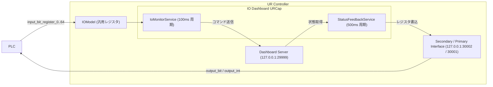

# IO Dashboard URCap

[日本語](./README.md) | [English](./README_EN.md)

Universal Robots (e-Series / PolyScope 5) 用の URCap です。  
EtherNet/IP や PROFINET、Modbus などのフィールドバス汎用レジスタを介して、PLC から Dashboard Server コマンドの実行およびロボット状態の取得を行います。

---

## 概要

通常、Universal Robots の Dashboard Server（ポート 29999）を制御するには TCP ソケット通信が必要ですが、本 URCap を導入することで、PLC 側の汎用ビット入力（`input_bit_register`）の ON/OFF だけで電源投入・ブレーキ解除・プログラム再生/停止などの制御が可能になります。  
また、ロボットの現在の状態（リモート状態、電源状態、セーフティ状態など）を汎用ビット出力（`output_bit_register`）および汎用整数出力（`output_int_register`）へ周期的に反映します。ロボットプログラムが停止中であってもバックグラウンドで動作します。

### 動作環境

- **対応ロボット**: Universal Robots e-Series (PolyScope 5.x)
- **URCap API**: 1.17.0
- **Java**: 1.8

---

## 構成



---

## 機能と仕様

PolyScope の「設置設定 (Installation)」＞「IO Dashboard」から以下の4つのタブで設定・確認を行います。  
PolyScope の「I/O設定」でレジスタにカスタム名を設定している場合、ドロップダウンリストにはその名称が表示されます。

### 1. 入力制御 (PLC → UR)

割り当て可能なレジスタ: `input_bit_register_0` 〜 `input_bit_register_64`  
信号の立ち上がりエッジ（`0 → 1`）を100ms周期で検出し、対応する Dashboard Server コマンドを実行します。

| 項目名 | 実行される Dashboard コマンド | 備考 |
| :--- | :--- | :--- |
| 一括起動 (電源ON & ブレーキ解除) | `power on` → `brake release` | `power on` 送信後、`IDLE` 状態になるのを待ってから `brake release` を送信（最大15秒待機） |
| 電源ON (Power On) | `power on` | |
| ブレーキ解除 (Brake Release) | `brake release` | |
| 電源OFF (Power Off) | `power off` | |
| プログラム再生 (Play) | `play` | |
| プログラム停止 (Stop) | `stop` | |
| プログラム一時停止 (Pause) | `pause` | |
| 保護停止解除 & ポップアップ消去 | `unlock protective stop` / `close safety popup` / `close popup` | |
| ポップアップ消去 (Close Popup) | `close safety popup` / `close popup` | |
| セーフティリスタート (Restart Safety) | `restart safety` | |

### 2. 出力状態 (UR → PLC: ビット)

割り当て可能なレジスタ: `output_bit_register_0` 〜 `output_bit_register_64`  
500ms周期でロボットの状態を監視し、割り当てた汎用ビット出力レジスタへ出力します。

| 項目名 | 出力条件 (`1: ON` となる条件) |
| :--- | :--- |
| Is in Remote Control (リモート中) | ロボットがリモートコントロールモード中 |
| Is Program Running (再生中) | プログラムが再生中 (`RUNNING` / `PLAYING`) |
| Is Robot Power On (電源ON) | ロボットアームの電源が ON (`POWER_ON`, `IDLE`, `RUNNING`) |
| Is Robot Ready / Idle (運転可能) | ブレーキ解除済みで動作可能 (`IDLE` または `RUNNING`) |
| Is Safety Normal (正常) | セーフティステータスが `NORMAL` または `REDUCED` |
| Is Protective Stopped (保護停止中) | セーフティステータスが `PROTECTIVE_STOP` |
| Is Emergency Stopped (非常停止中) | セーフティステータスが `EMERGENCY_STOP` |

### 3. 整数コード & ハンドシェイク

#### 多値状態の整数コード出力 (`output_int_register_0` 〜 `output_int_register_47`)

| 項目名 | 出力コード仕様 |
| :--- | :--- |
| **Robot Mode Code** | `0`: DISCONNECTED / NO_CONTROLLER<br>`1`: POWER_OFF<br>`2`: BOOTING<br>`3`: POWER_ON<br>`4`: IDLE<br>`5`: BACKDRIVE<br>`6`: CONFIRM_SAFETY<br>`7`: RUNNING<br>`-1`: UNKNOWN |
| **Safety Status Code** | `0`: UNKNOWN<br>`1`: NORMAL<br>`2`: REDUCED<br>`3`: PROTECTIVE_STOP<br>`4`: SAFEGUARD_STOP<br>`5`: EMERGENCY_STOP<br>`6`: VIOLATION / FAULT |
| **Program State Code** | `0`: NONE / UNKNOWN<br>`1`: STOPPED<br>`2`: PLAYING<br>`3`: PAUSED |
| **Last Error Code** | `0`: 正常<br>`1`: ファイルなし<br>`2`: セーフティ未確認<br>`3`: 実行拒否 / タイムアウト<br>`4`: 通信エラー |

#### コマンド実行ハンドシェイク信号

| 信号名 | 対象レジスタ | 動作 |
| :--- | :--- | :--- |
| Command Busy (処理中) | `output_bit_register_0..64` | コマンド実行中に `1 (ON)`、完了時に `0 (OFF)` |
| Command Done (正常完了) | `output_bit_register_0..64` | コマンド正常完了時に `1.5秒間 1 (ON)` 後、自動で `0 (OFF)` |
| Command Error (実行エラー) | `output_bit_register_0..64` | コマンド失敗時に `1 (ON)` |
| Last Error Code 出力先 | `output_int_register_0..47` | 直近のコマンド実行結果エラーコードを出力 |

### 4. 通信ログ

Dashboard Server および Primary Interface との接続状況、実行されたコマンドと応答、出力レジスタの更新履歴（直近50件）を画面上で確認できます。

---

## インストールと使い方

1. `target/IO_dashboard-1.2.0.urcap` を USB メモリ等で UR コントローラにコピーします。
2. PolyScope 右上のメニューから「設定」＞「システム」＞「URCaps」を開き、`+` ボタンから `.urcap` ファイルを選択して再起動します。
3. 「設置設定 (Installation)」＞「IO Dashboard」を開き、使用する入出力レジスタを割り当てて設置設定を保存します。
4. PLC から `play` や `power on` などの Dashboard コマンドを受け付けるには、PolyScope を **リモートコントロールモード (Remote Control)** に切り替えてください。

---

## ビルド方法

Maven を使用してビルドとユニットテストを実行します。

```bash
mvn clean test package
```

ビルドが成功すると、`target/IO_dashboard-1.2.0.urcap` が生成されます。

---

## ライセンス

MIT License
