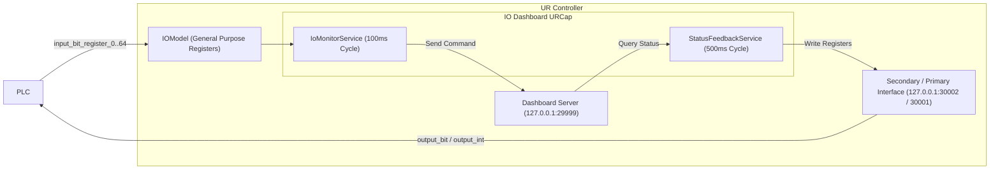

# IO Dashboard URCap

[日本語](./README.md) | [English](./README_EN.md)

A URCap for Universal Robots (e-Series / PolyScope 5).  
It enables executing Dashboard Server commands from a PLC and outputting robot status to the PLC via general-purpose fieldbus registers (EtherNet/IP, PROFINET, Modbus, etc.).

---

## Overview

Controlling the Universal Robots Dashboard Server (port 29999) normally requires raw TCP socket communication. With this URCap, a PLC can trigger actions such as powering on the arm, releasing brakes, and playing/stopping programs simply by toggling general-purpose input bits (`input_bit_register`).  
It also periodically writes the current robot status (remote control state, power state, safety status, etc.) to general-purpose boolean (`output_bit_register`) and integer (`output_int_register`) output registers. The background service runs continuously even when the robot program is stopped.

### Requirements

- **Robot**: Universal Robots e-Series (PolyScope 5.x)
- **URCap API**: 1.17.0
- **Java**: 1.8

---

## Architecture



---

## Features & Specifications

Configure and monitor settings under **Installation > IO Dashboard** in PolyScope across four tabs.  
If custom names are assigned to registers in PolyScope's **I/O Setup**, they are automatically reflected in the dropdown lists.

### 1. Input Control (PLC → UR)

Assignable registers: `input_bit_register_0` to `input_bit_register_64`  
Detects a rising edge (`0 → 1`) at a 100ms polling interval and executes the assigned Dashboard Server command.

| Action | Dashboard Command | Notes |
| :--- | :--- | :--- |
| Power On & Brake Release | `power on` → `brake release` | Sends `power on`, waits until robot mode reaches `IDLE` (up to 15s), then sends `brake release` |
| Power On | `power on` | |
| Brake Release | `brake release` | |
| Power Off | `power off` | |
| Play Program | `play` | |
| Stop Program | `stop` | |
| Pause Program | `pause` | |
| Unlock Protective Stop & Close Popup | `unlock protective stop` / `close safety popup` / `close popup` | |
| Close Popup | `close safety popup` / `close popup` | |
| Restart Safety | `restart safety` | |

### 2. Status Output (UR → PLC: Boolean)

Assignable registers: `output_bit_register_0` to `output_bit_register_64`  
Queries robot status every 500ms and updates the assigned boolean output registers.

| Status Item | Condition for `1 (ON)` |
| :--- | :--- |
| Is in Remote Control | Robot is in Remote Control mode |
| Is Program Running | Program is currently running (`RUNNING` / `PLAYING`) |
| Is Robot Power On | Robot arm power is ON (`POWER_ON`, `IDLE`, or `RUNNING`) |
| Is Robot Ready / Idle | Brakes are released and robot is ready to move (`IDLE` or `RUNNING`) |
| Is Safety Normal | Safety status is `NORMAL` or `REDUCED` |
| Is Protective Stopped | Safety status is `PROTECTIVE_STOP` |
| Is Emergency Stopped | Safety status is `EMERGENCY_STOP` |

### 3. Integer Codes & Handshake

#### Multi-state Integer Code Outputs (`output_int_register_0` to `output_int_register_47`)

| Item | Output Code Values |
| :--- | :--- |
| **Robot Mode Code** | `0`: DISCONNECTED / NO_CONTROLLER<br>`1`: POWER_OFF<br>`2`: BOOTING<br>`3`: POWER_ON<br>`4`: IDLE<br>`5`: BACKDRIVE<br>`6`: CONFIRM_SAFETY<br>`7`: RUNNING<br>`-1`: UNKNOWN |
| **Safety Status Code** | `0`: UNKNOWN<br>`1`: NORMAL<br>`2`: REDUCED<br>`3`: PROTECTIVE_STOP<br>`4`: SAFEGUARD_STOP<br>`5`: EMERGENCY_STOP<br>`6`: VIOLATION / FAULT |
| **Program State Code** | `0`: NONE / UNKNOWN<br>`1`: STOPPED<br>`2`: PLAYING<br>`3`: PAUSED |
| **Last Error Code** | `0`: Normal (No Error)<br>`1`: File Not Found<br>`2`: Safety Not Confirmed<br>`3`: Command Rejected / Timeout<br>`4`: Communication Error |

#### Command Execution Handshake Signals

| Signal | Target Register | Behavior |
| :--- | :--- | :--- |
| Command Busy | `output_bit_register_0..64` | `1 (ON)` while command is executing, `0 (OFF)` when finished |
| Command Done | `output_bit_register_0..64` | `1 (ON)` for 1.5 seconds upon successful completion, then resets to `0 (OFF)` |
| Command Error | `output_bit_register_0..64` | `1 (ON)` if command execution fails |
| Last Error Code | `output_int_register_0..47` | Outputs the error code of the most recent command execution |

### 4. Communication Log

Displays the connection status for the Dashboard Server and Primary Interface, along with the latest 50 log entries of executed commands, responses, and register updates.

---

## Installation & Usage

1. Copy `target/IO_dashboard-1.2.0.urcap` to the UR controller via USB drive or network.
2. In PolyScope, open **Settings > System > URCaps**, click `+`, select the `.urcap` file, and restart PolyScope.
3. Go to **Installation > IO Dashboard**, assign the desired input and output registers, and save the Installation.
4. Ensure PolyScope is switched to **Remote Control** mode so that Dashboard commands (`play`, `power on`, etc.) from the PLC are accepted by the controller.

---

## Build

Run the following Maven command to execute unit tests and package the `.urcap` bundle:

```bash
mvn clean test package
```

The packaged file will be generated at `target/IO_dashboard-1.2.0.urcap`.

---

## License

MIT License
